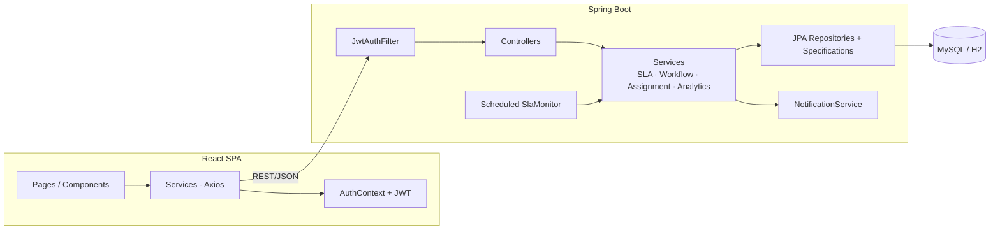

# ITServe — Enterprise IT Service Desk

> **Raise. Resolve. Track. Improve.**

A production-style, full-stack IT Service Desk / Helpdesk platform. Employees raise tickets,
admins assign them to the right support agents, agents investigate and resolve them under
SLA deadlines, and employees confirm, close and rate the support — with live dashboards,
notifications, a knowledge base and rule-based incident-trend detection along the way.

Built as a clean, understandable **enterprise monolith**: Spring Boot 3 REST API + React SPA.

---

## Features

- **JWT authentication + role-based access control** — ADMIN, SUPPORT_AGENT, EMPLOYEE, with
  server-side authorization on every operation (frontend role info is never trusted)
- **Ticket lifecycle state machine** — OPEN → ASSIGNED → IN_PROGRESS → WAITING_FOR_USER →
  RESOLVED → CLOSED, plus REOPENED and ESCALATED paths, with validated transitions per role
- **SLA management** — priority-based deadlines (CRITICAL 2h / HIGH 4h / MEDIUM 8h / LOW 24h),
  live “03h 42m remaining / SLA BREACHED” badges, a scheduled at-risk & breach monitor,
  compliance %, average resolution and first-response times
- **Smart agent suggestion** — deterministic ranking by category/skill match, then current
  workload, then name
- **Comments, attachments, full activity timeline** (history + comments merged)
- **In-app notifications** — assignment, status changes, comments, resolution, reopen,
  SLA at-risk/breached, ratings; navbar bell with unread count
- **Role-specific dashboards** — all metrics computed from live data (KPIs, status/priority/
  category charts, 14-day created-vs-resolved series, agent workload)
- **Incident trend detection** — rule-based week-over-week category volume analysis
  (≥ 3 tickets and ≥ 50 % increase ⇒ “Potential incident”)
- **Knowledge base** — searchable articles with helpful Yes/No voting
- **Support ratings** — 1–5 stars + feedback after resolution, aggregated in admin analytics
- **Search, filtering, sorting, pagination** — server-side via JPA Specifications
- **Swagger/OpenAPI docs**, centralized exception handling, Bean Validation, BCrypt hashing

## Technology stack

| Layer    | Tech |
|----------|------|
| Backend  | Java 17, Spring Boot 3.5 (Web, Data JPA, Security, Validation), JWT (jjwt 0.12), springdoc-openapi, Lombok, Maven |
| Database | H2 in-memory (default dev profile) · MySQL 8 (`mysql` profile) |
| Frontend | React 18, Vite, React Router, Axios, Bootstrap 5 + bootstrap-icons, Recharts |
| Testing  | JUnit 5, Mockito, Spring Boot Test, MockMvc |

## Architecture

```text
React Frontend (Vite :5173)
      |  REST / JSON, Bearer JWT (Axios, dev proxy /api -> :8081)
      v
Spring Boot Backend (:8081)
      |  Controller -> Service -> Repository (Entity/DTO/Security/Exception)
      v
MySQL / H2 Database
```



Details: [docs/architecture.md](docs/architecture.md) · API reference: [docs/api.md](docs/api.md)

## Repository layout

```text
itserve/
├── backend/     Spring Boot API (com.itserve)
├── frontend/    React + Vite SPA
├── database/    schema.sql, seed.sql (MySQL reference scripts)
├── docs/        architecture.md, api.md
├── .env.example environment template
└── README.md
```

## Getting started

Prerequisites: **JDK 17+**, **Maven 3.9+**, **Node.js 18+**. No database install needed
(H2 in-memory by default). First time on a fresh machine? Follow the step-by-step
[SETUP_GUIDE.md](SETUP_GUIDE.md) (Windows install commands + troubleshooting).

### 1. Backend

```bash
cd backend
mvn spring-boot:run
```

Runs on **http://localhost:8081** (override with `SERVER_PORT`), seeds demo data on first
start, and exposes:

- Swagger UI: http://localhost:8081/swagger-ui.html
- H2 console: http://localhost:8081/h2-console (JDBC URL `jdbc:h2:mem:itserve`, user `sa`, empty password)

Run the tests:

```bash
mvn test
```

### 2. Frontend

```bash
cd frontend
npm install
npm run dev
```

Opens on **http://localhost:5173** (falls back to 5174 if taken) and proxies `/api` to
`http://localhost:8081`.

### 3. Log in

| Role          | Email                 | Password       |
|---------------|-----------------------|----------------|
| Admin         | `admin@itserve.com`     | `Password@123` |
| Support agent | `agent1@itserve.com`    | `Password@123` |
| Support agent | `agent2@itserve.com`    | `Password@123` |
| Support agent | `agent3@itserve.com`    | `Password@123` |
| Employee      | `employee1@itserve.com` | `Password@123` |
| Employee      | `employee2@itserve.com` | `Password@123` |
| Employee      | `employee3@itserve.com` | `Password@123` |

The login page has one-click demo-account buttons.

### Demo data

Seeding (`app.seed-demo-data=true`, default) creates 7 users, 9 categories, 4 SLA rules,
26+ tickets across every status/priority (including breached and resolved-with-rating ones),
comments, notifications, history entries and 6 knowledge-base articles.

## The full workflow to demo

1. **employee1** logs in → *Raise New Ticket* → submits (ticket number, SLA deadline generated)
2. **admin** logs in → sees the open ticket → *Assign* → picks the top **suggested agent**
   (skill match + workload)
3. **agent1** logs in → notification bell shows the assignment → moves the ticket
   *In Progress* → adds a comment → *Resolve* with a mandatory resolution note
4. **employee1** logs in → gets notified → reviews the resolution note → *Close* →
   rates the support 1–5★
5. **admin** dashboard updates live: KPIs, SLA compliance, charts, agent workload,
   incident trends

## Environment variables

See [.env.example](.env.example). Key variables: `DB_URL`, `DB_USERNAME`, `DB_PASSWORD`
(only for the `mysql` profile), `JWT_SECRET`, `JWT_EXPIRATION_MINUTES`, `SERVER_PORT`,
`CORS_ORIGINS`, `SEED_DEMO_DATA`.

### Running with MySQL

```bash
mysql -u root -p < database/schema.sql   # optional; ddl-auto can create the schema
mysql -u root -p < database/seed.sql     # optional baseline data

cd backend
mvn spring-boot:run -Dspring-boot.run.profiles=mysql
```

with `DB_URL`, `DB_USERNAME`, `DB_PASSWORD` (and a real `JWT_SECRET`) exported.

## API documentation

Full endpoint table in [docs/api.md](docs/api.md); interactive Swagger UI at
`http://localhost:8081/swagger-ui.html` (click **Authorize** and paste a JWT from login).

## Testing

```bash
cd backend && mvn test
```

18 tests cover: ticket workflow transitions & role rules (unit), SLA deadline computation
(Mockito), and an end-to-end API integration suite (MockMvc): authentication, RBAC 401/403s,
the complete create → assign → progress → comment → resolve → close → rate lifecycle,
validation errors, dashboards, search/filter/pagination, knowledge base and employee
data-scoping.

## Security notes

- BCrypt password hashing; no passwords in responses or logs
- Stateless JWT; roles always re-validated from the database
- `@PreAuthorize` + service-layer ownership checks on every protected operation
- Consistent error envelope — stack traces are never exposed to clients
- CORS restricted to configured origins; dev-only JWT secret defaults are flagged in `.env.example`

## Future enhancements

- Real-time updates via WebSocket/SSE instead of polling notifications
- Email/Teams/Slack notification channels
- Attachment storage on S3-compatible object storage instead of the database
- Business-hours-aware SLA calendars and per-category SLA targets
- CSAT reporting exports and scheduled report emails
