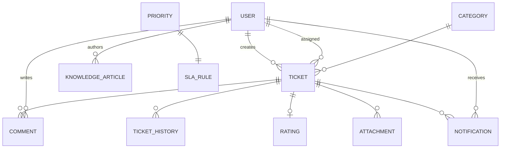

# ITServe — Architecture

## Overview

ITServe is an enterprise-style **monolithic** full-stack application. A React SPA talks to a
Spring Boot REST API secured with JWT; all business rules live in the backend service layer,
and data is stored in a relational database (H2 in-memory by default, MySQL via the `mysql`
profile).

```text
React (Vite, :5173)
      |
      | REST / JSON  (Axios, Bearer JWT)
      v
Spring Boot (:8081)
      |
      +-- Controller   REST endpoints, request/response DTOs, @PreAuthorize
      +-- Service      Business rules: SLA, workflow, assignment, analytics
      +-- Repository   Spring Data JPA (+ Specifications for search/filter)
      +-- Entity       JPA entities (never exposed to clients)
      +-- DTO          Records used for all API input/output
      +-- Security     JWT filter, UserDetailsService, SecurityConfig
      +-- Exception    @RestControllerAdvice -> consistent error JSON
      |
      v
MySQL / H2
```

## Backend layers

| Layer        | Package            | Responsibility                                                                 |
|--------------|--------------------|--------------------------------------------------------------------------------|
| Controller   | `com.itserve.controller` | HTTP mapping, validation trigger, role guards (`@PreAuthorize`)          |
| Service      | `com.itserve.service`    | Business logic and transactions                                          |
| Repository   | `com.itserve.repository` | Spring Data JPA queries, aggregations, `JpaSpecificationExecutor`        |
| Entity       | `com.itserve.entity`     | JPA entities with indexes on hot columns (status, priority, created_at…) |
| DTO          | `com.itserve.dto`        | Java records; entities never leave the service layer                     |
| Security     | `com.itserve.security`   | `JwtService`, `JwtAuthFilter`, `UserPrincipal`, `DbUserDetailsService`   |
| Exception    | `com.itserve.exception`  | Domain exceptions + `GlobalExceptionHandler`                             |
| Config       | `com.itserve.config`     | `SecurityConfig`, `OpenApiConfig`, `DataSeeder`                           |

## Key design decisions

### Authentication & authorization
- Stateless JWT (HS512, jjwt 0.12.x). The token carries `sub` (email), `uid` and `role` claims,
  but **the role is always re-read from the database** via `DbUserDetailsService` — frontend
  role info is never trusted.
- `SecurityConfig` permits only `/api/auth/login|register`, Swagger and the H2 console;
  everything else requires authentication. `/api/users/**` is ADMIN-only, `/api/agents/**`
  is ADMIN+SUPPORT_AGENT.
- Passwords are BCrypt-hashed; hashes never appear in any DTO.

### Ticket workflow state machine
`TicketWorkflow` holds an explicit allowed-transition map and role rules:

```text
OPEN ──> ASSIGNED ──> IN_PROGRESS ──> WAITING_FOR_USER
                │            │  ▲            │
                │            │  └────────────┘
                │            v
OPEN/ASSIGNED/IN_PROGRESS ──> ESCALATED ──> ASSIGNED/IN_PROGRESS
IN_PROGRESS ──> RESOLVED ──> CLOSED
RESOLVED ──> REOPENED ──> ASSIGNED/IN_PROGRESS
```

- EMPLOYEE (owner only): may move RESOLVED → CLOSED or RESOLVED → REOPENED. Nothing else.
- SUPPORT_AGENT: may not close/reopen; must be the assignee (except picking up OPEN/ESCALATED).
- ADMIN: unrestricted.
- Invalid jumps raise `InvalidTicketStatusException` (HTTP 422); acting on a CLOSED ticket
  raises `TicketAlreadyClosedException` (HTTP 409).

### SLA engine
1. `SlaRule` maps priority → target hours (CRITICAL 2, HIGH 4, MEDIUM 8, LOW 24).
2. On creation, `SlaService.computeDeadline` sets `slaDeadline = createdAt + hours`.
   Priority changes recalculate the deadline.
3. `TicketResponse.from` derives the UI state: `BREACHED`, `AT_RISK` (≤ 60 min left),
   `MET` (resolved before deadline), `OK`, plus `slaRemainingMinutes`.
4. A `@Scheduled` monitor (every 15 min) creates *SLA at risk* / *SLA breached* notifications
   for the assigned agent, guarded by `slaAtRiskNotified` / `slaBreachedNotified` flags so each
   ticket only notifies once per level.

### Smart agent suggestion
Deterministic and explainable — for a ticket's category, rank active agents by:

```text
1. skillMatch  (agent.skills contains the category name)  DESC
2. activeTickets (open+assigned+in-progress+waiting+escalated+reopened) ASC
3. fullName ASC (stable tie-break)
```

### Search, filtering, pagination
`TicketSpecifications` composes JPA `Specification` predicates (search text, status, priority,
category, creator, assignedTo me/unassigned/agent, SLA breached/at-risk, date range) which
`TicketService.list` combines with `Pageable`. EMPLOYEE results are always scoped server-side
to their own tickets.

### Analytics & incident trend detection
`DashboardService` computes every number from live queries (group-by counts, 14-day series,
agent workload, SLA compliance, average resolution / first-response times, average rating).
Trend detection compares per-category ticket volume for the last 7 days vs the prior 7 days and
flags categories with ≥ 3 tickets and ≥ 50 % increase — a simple, transparent rule, not ML.

## Frontend structure

```text
src/
├── components/      Layout (sidebar/topbar), Navbar pieces, NotificationBell,
│   │                TicketTable, Status/Priority/Sla badges, KpiCard,
│   │                ProtectedRoute, ToastProvider
│   └── dashboard/   AdminDashboard, AgentDashboard, EmployeeDashboard, Charts (recharts)
├── pages/           Login, Dashboard, Tickets, TicketDetails, CreateTicket,
│                    Users, KnowledgeBase, Profile
├── services/        api.js (Axios + interceptors), auth/ticket/dashboard services
├── context/         AuthContext (token+user in localStorage)
└── utils/           format.js (status/priority/SLA formatting)
```

- `api.js` attaches `Authorization: Bearer <token>` to every request and, on 401, clears
  storage and redirects to `/login`.
- `ProtectedRoute` guards routes; role-restricted pages (Users) are wrapped with
  `roles={['ADMIN']}`. These are UX guards only — the API re-checks every permission.
- Vite dev server proxies `/api` → `http://localhost:8081`, so the browser only ever
  talks to one origin (no CORS issues in dev).

## Data model



See `database/schema.sql` for the full DDL including indexes.

## Error handling contract

All errors return the same JSON shape (never a stack trace):

```json
{
  "timestamp": "2026-09-27T12:30:00Z",
  "status": 404,
  "error": "RESOURCE_NOT_FOUND",
  "message": "Ticket not found",
  "path": "/api/tickets/123",
  "fieldErrors": null
}
```

| HTTP | When                                                        |
|------|-------------------------------------------------------------|
| 401  | Missing/invalid JWT, bad credentials                        |
| 403  | Authenticated but role/ownership check failed               |
| 404  | Unknown resource id                                         |
| 409  | Duplicate email, action on a CLOSED ticket                  |
| 422  | Bean-validation failure (`fieldErrors` map) or invalid status transition |
| 500  | Unexpected server error (generic message only)              |
